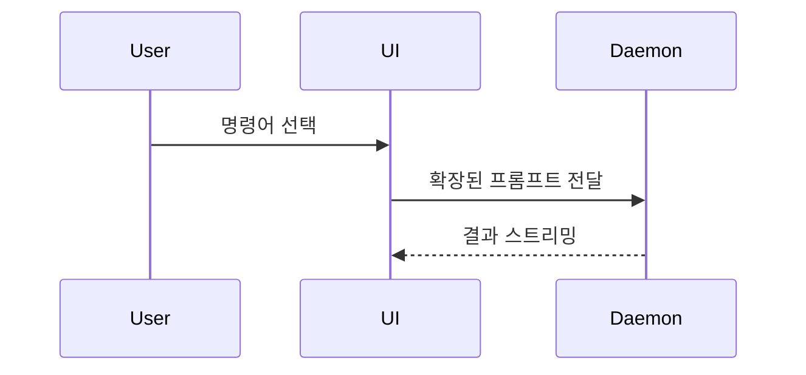

PR(풀 리퀘스트) 본문을 작성할 때 다음 템플릿을 사용하세요:

```markdown
## 요약 (Summary)

<다이어그램, diff 스케치, 또는 트리 구조>

## 근거 자료 (Evidence)

- **이전 (Before):** <스크린샷/실행 출력/실패한 테스트 실행>
  **이후 (After):** <스크린샷/실행 출력/통과한 테스트 실행>

## 병합 위험도 (Merge Danger)

**결정 유형 (Door):** <단방향(one-way) 또는 양방향(two-way)>

<선택 사항: 설명>

**영향 반경 (Blast Radius):** <한 단어 요약>

<선택 사항: 병합 시 발생 가능한 잠재적 파급 효과>
```

## 섹션 가이드 (Sections)

불필요한 서론은 생략하고 간결한 산문체를 유지하세요. `GLOSSARY.md`에 정의된 사용자의 도메인 용어를 사용하세요.

### 요약 (Summary)

핵심 내용을 가장 명확하게 전달할 수 있는 최소한의 시각적 요소를 선택하세요.

- 로직이나 알고리즘은 의사코드(pseudocode)로 표현:

```text
on(save)
  if content is unchanged
    return cached result
  write new content
  return fresh result
```

- 런타임 제어 흐름은 호출 트리(call tree)로 표현:

```text
submitForm
  createSession
    persistPrompt
    launchAgent
  navigateToSession
```

- UI 구조는 중요한 상태 및 모듈 경계를 포함하여 컴포넌트 트리(component tree)로 표현:

```text
<SessionPage> (apps/example/src/routes/session.tsx)
  useSessionEvents()
  <SessionToolbar>
    <RunSkillButton> (packages/ui)
```

- 파일 책임이나 대규모 리팩터링은 얕은 파일 트리(shallow file tree)로 표현:

```text
src/
├── commands/       # 사용자 액션 파싱
├── sessions/       # 세션 상태 관리
└── transport/      # API 요청 전송
```

- 컴포넌트 간 상호작용, 제어 흐름, 데이터 흐름은 Mermaid 다이어그램으로 표현:



- 핵심이 '무엇이 바뀌었는가'이고 주변 구조가 이미 명확할 때는 `diff`를 사용하세요. 주제에 맞게 diff 형태를 조율합니다.

컴포넌트 변경의 경우:

```diff
 <SessionPage>
   useSessionEvents()
   <SessionToolbar>
+    <RunSkillButton />
   <SessionTimeline>
+    <SkillResultCard />
```

파일 레이아웃 변경의 경우:

```diff
 src/
 ├── commands/
+│   └── show-me.ts       # 슬래시 명령어 확장
 ├── sessions/
-└── transport.ts
+└── transport/
+    ├── client.ts
+    └── stream.ts
```

호출 트리 또는 호출 스택 변경의 경우:

```diff
 submitForm
   createSession
     persistPrompt
+    expandSkillMention
     launchAgent
-  navigateToSession
+  navigateToSession
+    subscribeToEvents
```

상태 또는 제어 흐름 변경의 경우:

```diff
 on(save)
-  write content
+  if content is unchanged
+    return cached result
+  write new content
+  invalidate cache
```

- 대부분이 새로운 내용이거나 생략 시 소유권이나 순서가 모호해질 때, 또는 사용자가 복사 가능한 완성형 코드가 필요할 때는 전체 블록을 보여주세요:

```ts
function expandSkill(command: string): string {
  const skillName = command.slice(1);
  return `use the ${skillName} skill`;
}
```

#### 작성 지침

각 시각 자료는 이를 뒷받침하는 짧은 텍스트 바로 옆에 배치하세요. 사용자의 현재 질문에 답하거나 논의 지점을 해결하는 데 필요한 호출, 파일, props, 상태, 경계만 남기세요.

이 중 하나를 사용할 수도 있고 몇 가지를 함께 사용할 수도 있지만, 모든 요소를 전부 나열할 필요는 없습니다. 사용자가 압도당하지 않도록 상황에 맞게 판단하세요.

### 근거 자료 (Evidence)

변경 사항이 정상 작동한다는 구체적인 근거입니다. 전/후(Before & After)를 함께 보여주세요.

스크린샷은 S티어입니다 (환경이 갖추어져 있고 시각적인 변경 사항일 때).

실행 기반 근거는 A티어입니다. 테스트 결과, 콘솔 출력 등이 해당합니다. 의사코드를 활용하여 기존에 실패했다가 이제 통과하는 정확한 테스트를 명시하세요.

### 병합 위험도 (Merge Danger)

단방향 문(one-way door)인지 양방향 문(two-way door)인지 명시하세요. 양방향 문은 다시 돌아 나올 수 있지만, 단방향 문은 되돌리기 어렵습니다. 롤백 비용이 적은 PR은 위험도가 낮습니다. 파괴적인 작업이나 되돌리기 힘든 결정이 포함된 변경 사항은 단방향 문입니다.

영향 반경(Blast radius)은 이 PR로 인해 도입되는 변경 사항의 잠재적 영향 범위입니다. 모든 가능성을 고려하세요. 예: 레이아웃 틀어짐(layout shift), 외부 소비자에 미치는 영향, 모바일 반응형 깨짐 등.
